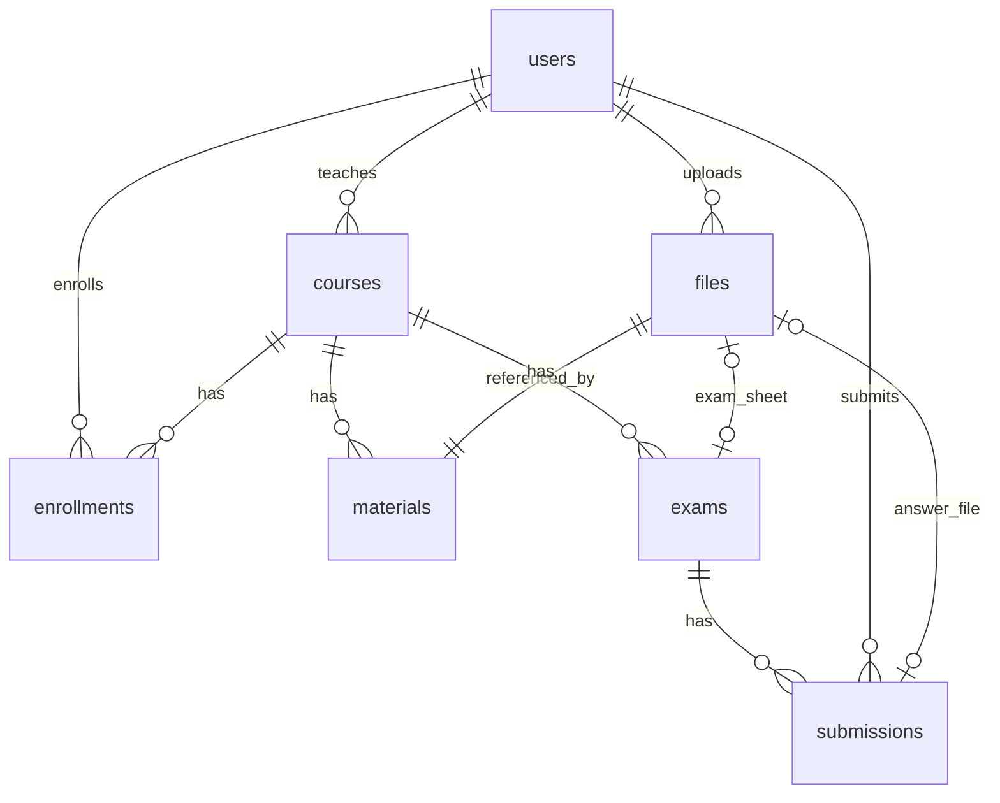

# Database Schema (SQLite)

MVP schema for the e-learning system. Definition only. The SQL migrations are created later in the `Datenbank Instanz` (Singleton) during initialization.

## Conventions
- **IDs:** `INTEGER PRIMARY KEY AUTOINCREMENT`
- **Timestamps:** `TEXT` in ISO 8601 (`2026-11-24T15:30:00Z`), default `CURRENT_TIMESTAMP`
- **Foreign keys:** enforced with `PRAGMA foreign_keys = ON`, which is set once when the DB instance is created
- **Enums:** `TEXT` column with a `CHECK` constraint (SQLite has no enum type)
- **Files:** stored on the host file system (e.g. `e_learning/uploads/`). The DB only holds the path and metadata.

## Overview

| Table         | Purpose                                  | Repository                          |
|---------------|------------------------------------------|-------------------------------------|
| `users`       | Accounts and their role                  | UserRepository / PermissionRepository |
| `courses`     | Courses created by teachers              | CourseRepository                    |
| `enrollments` | Students enrolled in courses             | CourseRepository                    |
| `materials`   | Links a course to an uploaded file       | CourseRepository                    |
| `files`       | Metadata and path of stored files        | ContentRepository                   |
| `exams`       | Exams belonging to a course              | ExamRepository                      |
| `submissions` | A student's exam attempt and its grade   | ExamRepository                      |

---

## Tables

### `users`
| Column          | Type    | Constraints                                              |
|-----------------|---------|----------------------------------------------------------|
| `id`            | INTEGER | PK                                                       |
| `username`      | TEXT    | NOT NULL, UNIQUE                                         |
| `password_hash` | TEXT    | NOT NULL                                                 |
| `role`          | TEXT    | NOT NULL, DEFAULT `'student'`, CHECK IN (`'student'`, `'teacher'`, `'admin'`) |
| `created_at`    | TEXT    | NOT NULL, DEFAULT CURRENT_TIMESTAMP                      |

- Each user has exactly one role, so no separate roles or permissions table is needed. The PermissionRepository reads and writes `role`.
- New registrations get `student`. An admin can change the role to `teacher` or `admin`.
- The first admin is created once as seed data during DB initialization.

### `courses`
| Column        | Type    | Constraints                                  |
|---------------|---------|----------------------------------------------|
| `id`          | INTEGER | PK                                           |
| `title`       | TEXT    | NOT NULL                                     |
| `description` | TEXT    |                                              |
| `teacher_id`  | INTEGER | NOT NULL, FK → `users.id` ON DELETE CASCADE  |
| `created_at`  | TEXT    | NOT NULL, DEFAULT CURRENT_TIMESTAMP          |

### `enrollments`
| Column        | Type    | Constraints                                   |
|---------------|---------|-----------------------------------------------|
| `user_id`     | INTEGER | NOT NULL, FK → `users.id` ON DELETE CASCADE   |
| `course_id`   | INTEGER | NOT NULL, FK → `courses.id` ON DELETE CASCADE |
| `enrolled_at` | TEXT    | NOT NULL, DEFAULT CURRENT_TIMESTAMP           |

- PK (`user_id`, `course_id`), so a student can enroll in a course only once.

### `files`
| Column          | Type    | Constraints                                       |
|-----------------|---------|---------------------------------------------------|
| `id`            | INTEGER | PK                                                |
| `original_name` | TEXT    | NOT NULL (name shown to the user, e.g. `Skript.pdf`) |
| `stored_path`   | TEXT    | NOT NULL, UNIQUE (relative path, e.g. `uploads/3f2a….pdf`) |
| `mime_type`     | TEXT    | NOT NULL                                          |
| `size_bytes`    | INTEGER | NOT NULL                                          |
| `uploaded_by`   | INTEGER | FK → `users.id` ON DELETE SET NULL                |
| `uploaded_at`   | TEXT    | NOT NULL, DEFAULT CURRENT_TIMESTAMP               |

- This is a generic table used by the Content Manager for course materials, exam sheets and exam answers.
- Files are saved under a generated name. This avoids name collisions and path tricks with user-supplied names.

### `materials`
| Column      | Type    | Constraints                                       |
|-------------|---------|---------------------------------------------------|
| `id`        | INTEGER | PK                                                |
| `course_id` | INTEGER | NOT NULL, FK → `courses.id` ON DELETE CASCADE     |
| `file_id`   | INTEGER | NOT NULL, UNIQUE, FK → `files.id` ON DELETE CASCADE |
| `title`     | TEXT    | NOT NULL                                          |

### `exams`
| Column        | Type    | Constraints                                    |
|---------------|---------|------------------------------------------------|
| `id`          | INTEGER | PK                                             |
| `course_id`   | INTEGER | NOT NULL, FK → `courses.id` ON DELETE CASCADE  |
| `title`       | TEXT    | NOT NULL                                       |
| `description` | TEXT    | (task text / instructions)                     |
| `file_id`     | INTEGER | FK → `files.id` ON DELETE SET NULL (optional exam sheet, e.g. a PDF) |
| `created_at`  | TEXT    | NOT NULL, DEFAULT CURRENT_TIMESTAMP            |

- Only students enrolled in the course can take the exam. This is checked by the Prüfungs-Manager, not the DB.

### `submissions`
| Column         | Type    | Constraints                                   |
|----------------|---------|-----------------------------------------------|
| `id`           | INTEGER | PK                                            |
| `exam_id`      | INTEGER | NOT NULL, FK → `exams.id` ON DELETE CASCADE   |
| `student_id`   | INTEGER | NOT NULL, FK → `users.id` ON DELETE CASCADE   |
| `answer_text`  | TEXT    | (answer typed in the browser)                 |
| `file_id`      | INTEGER | FK → `files.id` ON DELETE SET NULL (optional uploaded answer) |
| `submitted_at` | TEXT    | NOT NULL, DEFAULT CURRENT_TIMESTAMP           |
| `grade`        | REAL    | NULL until graded, CHECK `grade BETWEEN 1.0 AND 5.0` |
| `feedback`     | TEXT    | (teacher's comment)                           |
| `graded_at`    | TEXT    | NULL until graded                             |

- UNIQUE (`exam_id`, `student_id`), so each student can submit once per exam.
- The result is visible to the student (own submissions) and to the course's teacher (all submissions of the exam).

---

## Deliberately left out (MVP)
- Separate roles or permissions tables. One role per user is enough.
- Question/answer models and automatic grading. Exams are free text or a file and are graded manually.
- Deadlines, multiple attempts, course categories, soft deletes, audit fields.
